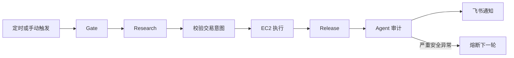

# SWIFT

**Simplest Workflow for Intent-based Forecast Trading**

SWIFT 是一个面向预测市场的自动研究与交易 Agent，力求用小型、低成本、易理解的系统完成从信息搜集到真实执行的闭环。

它自主检索公开信息，用概率图分解事件并估计最终结算结果的概率，将该估计作为模型公允价格；再与市场可成交价格比较。当优势足够显著且满足组合与风险约束时，SWIFT 生成结构化交易意图，交由隔离的执行器重新核验并提交。

研究、校验、发布、审计和通知都运行在 GitHub Actions。交易 signer 私钥只保存在 EC2 的本地受限文件中，研究 Agent 无法读取；workflow 只传递经过摘要绑定的交易意图，从架构上降低凭据暴露面。

## 执行流程

Research 只生成并校验决策，不接触交易凭据；EC2 执行器会重新检查账户、盘口、价格保护和已有挂单。完整结果发布后，独立 Judge Agent 审计证据。每轮都会通知，只有明确的资金或订单安全异常才停止后续交易。

## 资源需求

只需一台位于合规地区、长期运行的 EC2，作为 GitHub self-hosted execution runner：

- Ubuntu x86_64；
- 1–2 vCPU、2 GiB 内存即可起步；
- 16 GiB EBS 在实践中足够，建议 30 GiB，为日志、缓存和系统更新预留空间；
- 能主动访问 GitHub、Polymarket 和依赖源。

Research 使用 GitHub-hosted runner，不占用 EC2 的计算资源。

## 安装和用法

**生产环境强烈建议使用 private fork/private repository。** 准备私有 GitHub 仓库、上述 EC2、Kimi Code API Key、飞书机器人配置和可程序化签名的 Polymarket 账户，然后让 Coding Agent 阅读 [`AGENTS.md`](AGENTS.md)，按其中的部署与验收规则执行。

账户类型、签名者恢复和 CLOB 凭据初始化见 [`docs/polymarket-authentication.md`](docs/polymarket-authentication.md)。启用真实交易前，请完成测试、runner、网络合规、凭据权限和端到端诊断验收。

> SWIFT 会操作真实资金。请自行确认所在地区、账户和使用方式符合适用条款与法律，并从严格限额开始。

## 致谢

参考与灵感来源：[Alchemist-X/predict-raven](https://github.com/Alchemist-X/predict-raven)。
