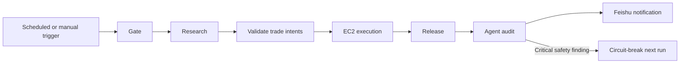

# SWIFT

**Simple Workflow for Intent-based Forecast Trading**

SWIFT is an automated research and trading agent for prediction markets. It is designed to complete the path from information gathering to real execution with a small, low-cost, understandable system.

It searches public information, decomposes events with a probabilistic graph, and estimates the probability of the final settlement outcome. That estimate becomes the model's fair price. SWIFT compares it with executable market prices and, when the edge is large enough and portfolio and risk constraints are satisfied, creates a structured trade intent for an isolated executor to re-check and submit.

Research, validation, release, audit, and notification run in GitHub Actions. The trading signer key remains in a restricted local file on EC2 and is never readable by the research agent; the workflow transfers only a digest-bound trade intent, reducing the credential exposure surface.

## Execution flow

Research produces and validates decisions without trading credentials. The EC2 executor re-checks the account, order book, price protection, and existing orders. After the complete result is released, an independent Judge Agent audits the evidence. Every run sends a notification; only an explicit funds or order-safety failure stops later trading.

## Resource requirements

Only one long-lived EC2 instance in a compliant region is required, serving as the GitHub self-hosted execution runner:

- Ubuntu x86_64;
- 1–2 vCPUs and 2 GiB RAM are a practical starting point;
- 16 GiB EBS has been sufficient in practice; 30 GiB is recommended for logs, caches, and system updates;
- outbound access to GitHub, Polymarket, and package registries.

Research runs on GitHub-hosted runners and does not consume EC2 compute resources.

## Installation and usage

Use a **private fork/private repository for production**. Prepare it together with the EC2 instance, a Kimi Code API key, Feishu bot configuration, and a programmable Polymarket account. Then ask a coding agent to read [`AGENTS.md`](AGENTS.md) and follow its deployment and acceptance rules.

For account types, signer recovery, and CLOB credential initialization, see [`docs/polymarket-authentication.md`](docs/polymarket-authentication.md). Before enabling live trading, complete the tests, runner, network-compliance, credential-permission, and end-to-end diagnostic checks.

> SWIFT can operate real funds. Confirm that your region, account, and usage comply with applicable terms and laws, and start with strict limits.

## Acknowledgements

Reference and inspiration: [Alchemist-X/predict-raven](https://github.com/Alchemist-X/predict-raven).
