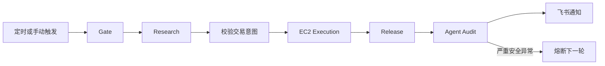

# SWIFT

**Simple Workflow for Intent-based Forecast Trading**

SWIFT 是一个面向预测市场的自动研究与交易 Agent，以尽可能简单、低成本的方式完成从信息搜集到真实执行的闭环。

它自主检索公开信息，用概率图分解事件并估计最终结果概率，将该概率视为公允价格，再与市场的可成交价格比较。当价差足够显著且满足组合与风险约束时，SWIFT 会生成结构化交易意图，交由隔离的执行器复核并成交。

除真实交易外，研究、校验、发布、审计和通知都运行在 GitHub Actions。交易私钥只保存在 EC2 的本地受限文件中，研究 Agent 无法读取；workflow 只向 EC2 传递经过摘要绑定的交易意图，从架构上降低凭据暴露风险。

## 执行流程

研究只生成并校验决策，不接触交易凭据；执行器在 EC2 上重新检查账户、盘口、价格保护和旧挂单。结果发布后，独立 Judge Agent 审计完整证据；每轮都会通知，只有明确的资金安全异常才熔断后续交易。

## 资源需求

只需一台长期运行、位于合规地区的 EC2 作为 GitHub self-hosted execution runner：

- Ubuntu x86_64；
- 1–2 vCPU、2 GiB 内存即可起步；
- 16 GiB EBS 在实践中足够，建议 30 GiB 以预留日志、缓存和系统更新空间；
- 可主动访问 GitHub、Polymarket 和依赖源。

Research 使用 GitHub-hosted runner，不占用 EC2 计算资源。

## 安装和用法

准备私有 GitHub 仓库、上述 EC2、Kimi Code API Key、飞书机器人配置和可程序化签名的 Polymarket 账户，然后让 Coding Agent 阅读 [`AGENTS.md`](AGENTS.md)，按其中的部署与验收规则执行。

账户类型、私钥恢复和 CLOB 凭据初始化见 [`docs/polymarket-authentication.md`](docs/polymarket-authentication.md)。启用真实交易前，请完成测试、runner、网络合规、凭据权限和端到端诊断验收。

> SWIFT 会操作真实资金。请自行确认所在地区、账户和使用方式符合适用条款与法律，并从严格限额开始。

## 致谢

参考与灵感来源：[issue_wong 的分享](https://x.com/issue_wong/status/2048222298197676286?s=20)。
